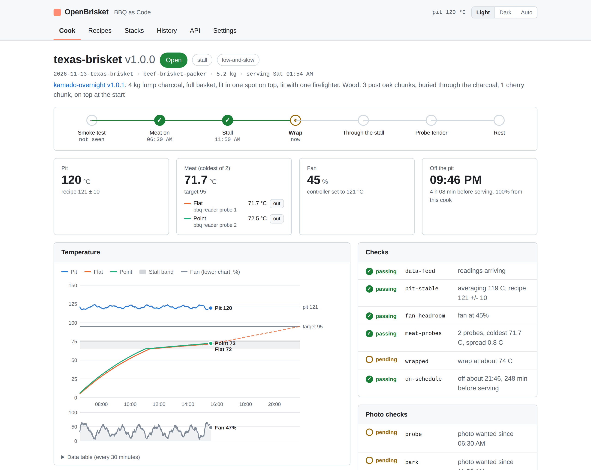
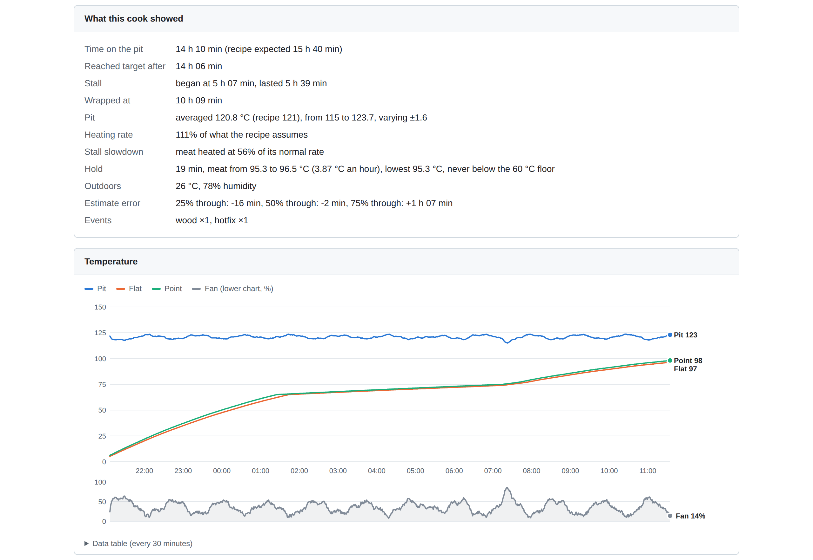
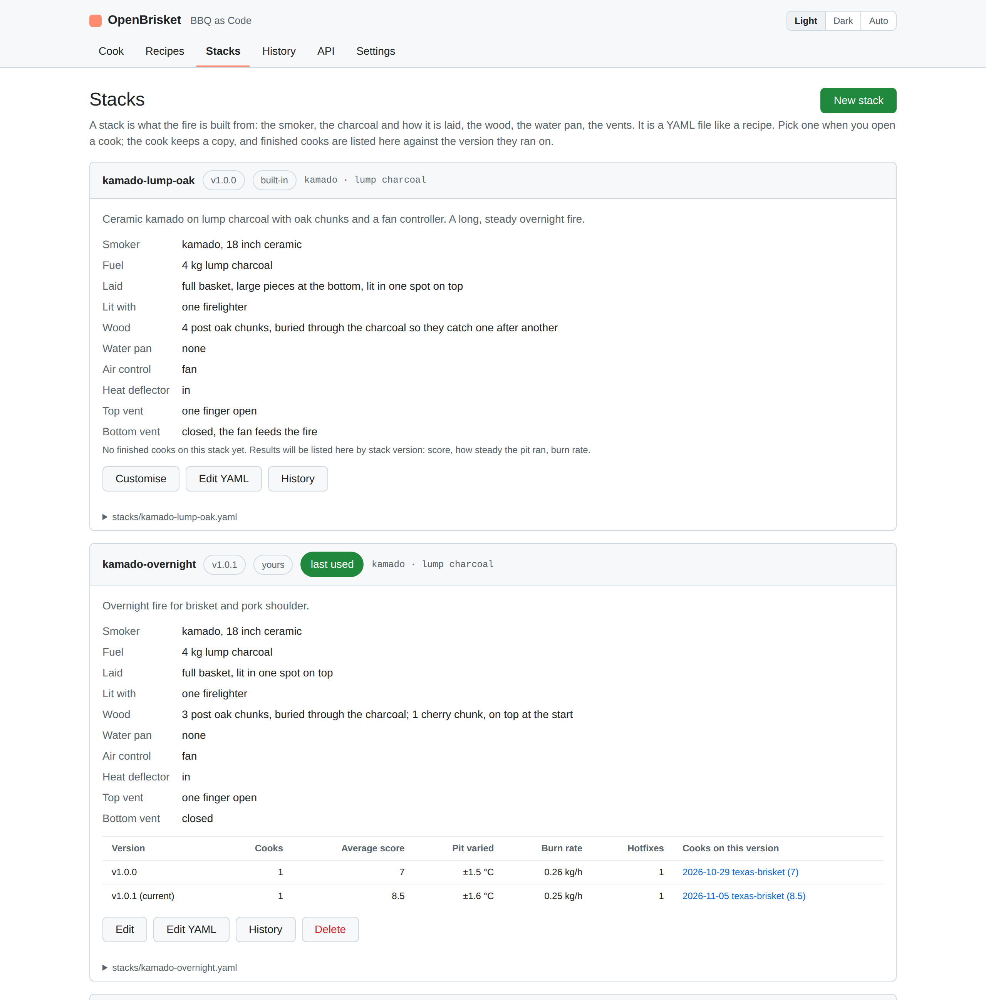
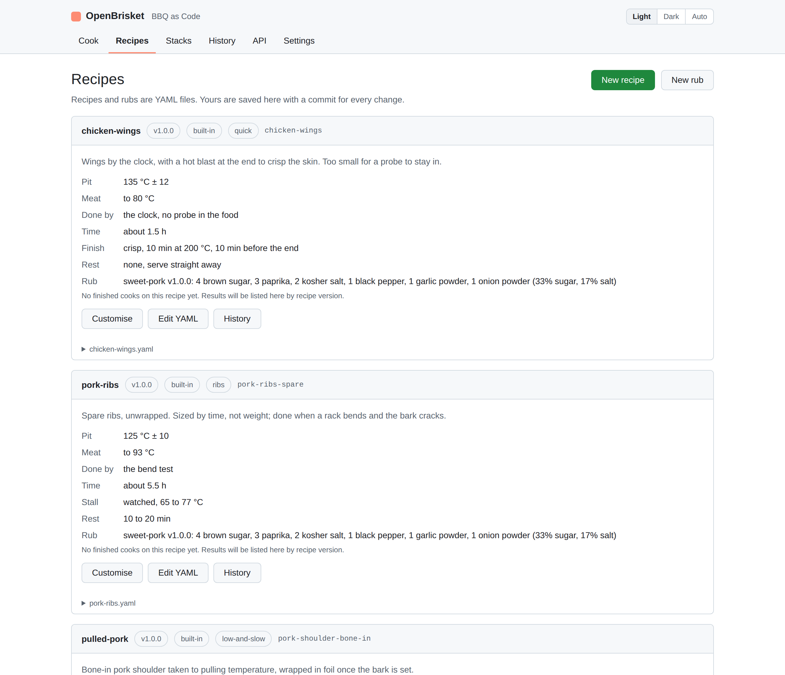
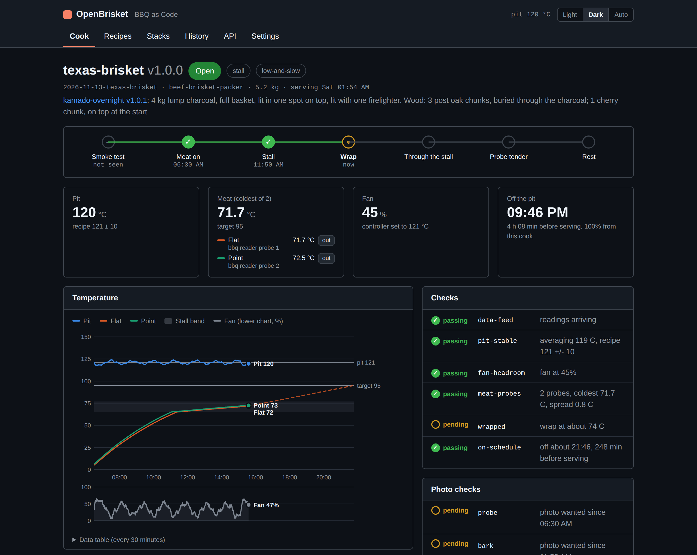
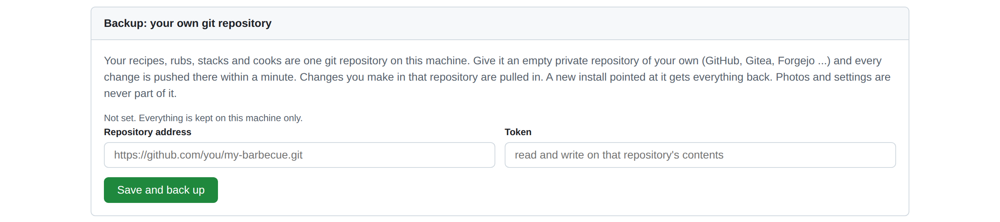
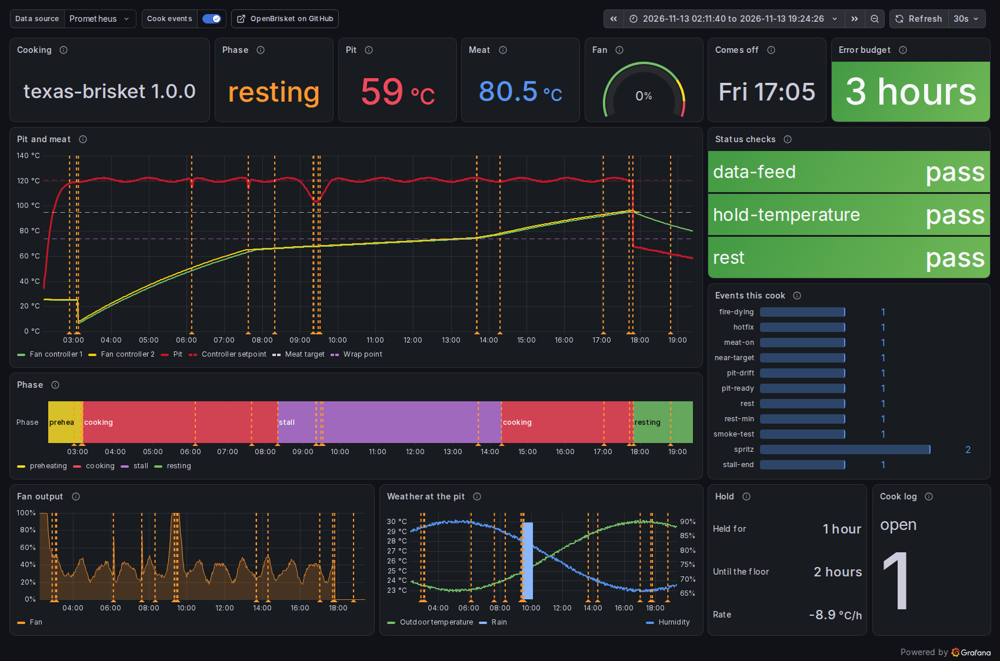

# OpenBrisket

BBQ as Code. OpenBrisket applies GitOps to smoking meat: recipes, rubs and the fire itself are YAML files in
git, every cook is a log of commits, and you are paged when the meat needs attention. The method is called
PitOps.

A brisket is a fourteen-hour deployment with a fixed deadline (dinner), a single production environment (the
table) and no rollback. Most cooks are run from memory, with three things changed since last time and no record
of which one helped.

PitOps holds that a backyard should be run like a well-governed GitOps organisation. Nothing reaches production
without a plan. No meat goes on until the pit has passed its smoke test, which is the only smoke test in the
industry that involves smoke. Every change has an author, a version and a reason. Nobody adds charcoal without
logging a hotfix. Agents attend the cook, inspect the bark and file their findings in a fixed vocabulary. The
pitmaster holds final approval and the tongs. On the question of pets versus cattle, PitOps is firmly on the
side of cattle, and has been since the first brisket. Pets are never cooked. Cowboy deploys are for people
whose servers are named Gandalf and Frodo and documented in a ring binder and a spreadsheet called
servers_final_v2.xls.



## What it does

- **Plans the cook.** Give it a recipe, the weight and the serving time. It works the whole timeline back from
  dinner: when to salt, when to light the fire, when the stall is expected, when to wrap, how long to rest.
- **Watches the pit.** It reads the pit temperature, the meat probes and the fan from Home Assistant and follows
  the cook against the recipe, with an estimate of the finish time that updates from the cook's own readings.
- **Pages you.** A note arrives when something needs doing: the pit is ready, the stall has started, it is time
  to wrap, the fire is dying, the lid has been left open, dinner is going to be late. On Telegram if a bot is
  set, in the terminal otherwise.
- **Keeps the record.** Every event in a cook is a commit. A finished cook is closed with a score and notes,
  and listed under the exact version of the recipe and the stack it ran on.
- **Shows what a change did.** Each version of a recipe or stack sits next to the cooks it produced: score, how
  steady the pit ran, burn rate, hotfixes. Change one thing, say why in the commit message, and the next cook
  answers the question.
- **Backs itself up.** Point it at a private git repository of your own and every change is pushed there.
- **Works with agents.** An MCP server and an agent skill let a chat agent plan, follow and close a cook.
- **Exports metrics.** `/metrics` serves the cook to Prometheus, and the repository has a Grafana dashboard and
  alert rules to go with it.

OpenBrisket monitors and advises. The fan controller stays in charge of the fire.

## How it maps

### The basics

| Infrastructure | Barbecue |
|---|---|
| Declarative config | A recipe is a YAML file: cut, rub, pit temperature, wrap point, target, rest |
| Modules | Rubs are files that recipes reference |
| Stack | The smoker, fuel, wood, water pan and vents, as a YAML file. Yes, a smoke stack. The same recipe runs on any of them |
| `plan` | The whole timeline, worked back from the serving time, before anything is lit |
| `apply` | Opens the cook |
| Smoke test | The check before the meat goes on. Also the CI job that validates recipes |
| Commit | Every event in a cook: meat on, stall detected, wrap, rest |
| Merge | Closing a finished cook with its score |
| Pull request | A formal request for someone to pull your pork. Also how a recipe joins the built-in set: CI runs the smoke test on it, and reviewers will ask how many times you have cooked it |
| Approval | The shoulder bone slides out clean |
| Code review | Somebody else eating it |
| Rollback | Available for recipes. Unavailable for brisket |

### Operations

| Infrastructure | Barbecue |
|---|---|
| Production | The table |
| Staging | There is none. Every cook is tested on guests |
| SLO | Dinner at the stated time |
| Error budget | The rest: 120 minutes ideal, 60 minimum. "Behind schedule" fires when the estimate starts spending it. Exported as `openbrisket_cook_error_budget_seconds` |
| Monitoring | Pit, meat probes and fan, read every 15 seconds |
| Observability | A `/metrics` endpoint, a Prometheus and a Grafana dashboard, for one piece of beef |
| Paging | The notes. In the example plan below, the stall pages at 04:46 |
| On-call | You |
| Agents | They plan the cook, watch it, look at photos of the bark and write it up. They do not get out of bed at 4 am. See On-call |
| Drift | The pit has left the range the recipe declares |
| Latency | The stall: the meat sits near 65 °C for hours and nothing appears to happen |
| Outage | Fire dying: fan at 90% for ten minutes and the pit still low |
| Hotfix | Adding fuel in the middle of a cook |
| Burn rate | Kilograms of fuel an hour |
| Post-incident review | The closing notes. "Flat a little dry." |
| Change advisory board | Whoever is standing nearest the smoker with an opinion |
| Separation of duties | The fan controller runs the fire. OpenBrisket watches and reports. You carry the meat |
| Compliance | A recipe that finishes below the safe temperature for its meat fails the smoke test |
| Disaster recovery | A new install pointed at your backup repository gets every recipe and cook back, with history |

### Kubernetes

| Infrastructure | Barbecue |
|---|---|
| Pets vs cattle | Cattle. This is the one field where the metaphor is literal. Do not name the brisket, and do not cook the pets |
| Manifest | Every recipe and stack starts with `apiVersion: openbrisket/v1` and a `kind`, because of course it does |
| Node | The smoker |
| Replicas | One. A brisket cannot be rescheduled to another node |
| Liveness probe | Is the fire still alive |
| Readiness probe | An actual probe, in the actual meat. The coldest one decides when it is done |
| Horizontal scaling | A second brisket |
| Vertical scaling | A bigger brisket |
| Persistent volume | The leftovers |
| Kubernetes required | No. It is one container. The brisket is already complicated enough |

## What it looks like

The screenshots use made-up cooks.

| | |
|---|---|
| **A finished cook.** What it showed, against what the recipe assumed, and the whole curve. | **Stacks.** The fire as a file, with results for each version: score, how steady the pit ran, burn rate, hotfixes. |
|  |  |
| **Recipes.** YAML files with a form on top and a history underneath. | **Dark theme.** For the 3 am check. |
|  |  |

**Backup.** Point the app at a private git repository of your own and every change is pushed there.



## A cook

```console
$ openbrisket plan recipes/texas-brisket.yaml --weight 5.4 --serve "2026-11-14 18:00"
Plan: texas-brisket v1.0.0 (beef-brisket-packer, 5.4 kg)
Pit 121 C, meat to 95 C, about 14.6 h on the pit

Fri 13 Nov
  11:57  salt / dry brine  - 12 h before the cook, uncovered in the fridge
  22:57  meat out of the fridge  - trim, apply the rub (rubs/dalmatian.yaml)
  23:12  light the fire  - bring the pit to 121 C, then run the smoke test
  23:57  meat on  - smoke test passed, probes in
Sat 14 Nov
  04:46  stall expected  - meat near 65 C; bark photo
  10:28  wrap  - at about 74 C, butcher paper
  14:32  probe tender (expected)  - meat at 95 C; feel test
  16:00  off and resting (latest)  - rest 120 min ideal, 60 min minimum
  18:00  serve

$ openbrisket apply recipes/texas-brisket.yaml --weight 5.4 --serve "2026-11-14 18:00"
$ openbrisket run            # leave this going for the whole cook
$ openbrisket smoke-test     # after lighting the fire
$ openbrisket log meat-on
$ openbrisket status
$ openbrisket log wrap
$ openbrisket log rest
$ openbrisket close --score 8.5 --cooked-weight 3.1 --notes "flat a little dry"
```

While `run` is going it leaves notes (on Telegram if you set a bot, in the terminal otherwise):

| Note | When |
|---|---|
| Pit ready | The pit has held the recipe's temperature for 15 minutes |
| Stall detected | Meat is in the stall band and rising slower than 2 °C an hour |
| Wrap point | Meat has reached the recipe's wrap temperature |
| Through the stall | Meat has left the stall band |
| Target reached | Time for the tenderness check |
| Lid open | The pit dropped 15 °C within a few minutes |
| Drift | The pit has averaged outside the recipe's range for 15 minutes |
| Fire dying | Fan at 90%+ for 10 minutes and the pit is still low |
| Behind schedule | The estimate leaves less than the minimum rest before serving |
| Probe or feed lost | No reading from the meat probe, or from the pit at all |
| Rest | Minimum and ideal rest reached |
| Hold | Meat within 4 °C of the holding floor, and again if it drops below it |

## What you need

- A smoker with a thermometer that something can read. Supported out of the box: Inkbird's ISC-027BW fan
  controller and IBT-26S thermometer, through a small ESP32 board (about the price of a bag of charcoal).
  Anything else that is already in Home Assistant works too.
- [Home Assistant](https://www.home-assistant.io). OpenBrisket reads its temperatures from there.
- Somewhere to run one Docker container: a home server, a NAS, a Raspberry Pi.

## Get it running

**1. The reader** (skip this if your thermometer is already in Home Assistant). Flash the ESP32 with
[ESPHome](https://esphome.io):

```console
$ pip install esphome
$ cd devices/esphome
$ cp secrets.example.yaml secrets.yaml          # your Wi-Fi, and a key from: openssl rand -base64 32
$ cp bbq-reader.example.yaml bbq-reader.yaml    # put in your devices' Bluetooth addresses
$ esphome run bbq-reader.yaml                   # board plugged in over USB the first time
```

Home Assistant then finds the board by itself and offers to add it. [devices/](devices/README.md) has the
details and the things worth knowing about each device.

**2. The app.**

```console
$ docker run -d --name openbrisket -p 8321:8321 -v openbrisket-data:/data ghcr.io/quinneydavid/openbrisket:latest
$ docker logs openbrisket | grep "access token"
```

Or clone this repository and run `docker compose up -d` (add `--build` to build the image yourself).

**3. Connect them.** Open http://localhost:8321 and paste the access token once. On the Settings page give the
address of Home Assistant, a long-lived access token (make a Home Assistant user for it that can only read),
and the entity for each value. "Test saved settings" shows a live reading when it is right. A Telegram bot for
notes is optional.

**4. Cook.** Describe your smoker and fuel once under Stacks, pick a recipe, give the serving time, press Apply.

Settings, your recipes and your cook log live in the `openbrisket-data` volume.

Without Docker (Python 3.10 or newer, and git):

```console
$ pip install .
$ openbrisket serve
```

The same commands the page uses are available in the terminal: `plan`, `apply`, `run`, `smoke-test`,
`log`, `status`, `history`, `close`. `openbrisket serve` follows the open cook by itself; `run` is for
using the terminal alone.

## The page

- **Cook**: the open cook as a row of stages, live temperatures, the curve with the estimate drawn
  ahead, status checks, buttons for the steps you do by hand, and the commit log. Put as many probes
  in the meat as you like: the coldest one decides when it is done.
- **Recipes**: every recipe and rub with its numbers and source file, the cooks and scores each recipe version
  produced, a History that shows exactly what changed between versions and why, and forms to write your own. What you
  save is a YAML file in your own library (`recipes/` in the data folder, a git repository), with a commit for
  every change. The built-in ones are read-only; "Customise" makes your copy.
- **Stacks**: what the fire is built from, as files with the same history as recipes, and what each version of a
  stack produced. See [Stacks](#stacks).
- **History**: a year of cooks at a glance, and each past cook with its curve, events and score.
- **API**: every endpoint with a Send button and the rights it needs. The same list is served as an OpenAPI 3 document at
  `/api/openapi.json`.
- **Settings**: readings (including a name for each probe, so you know which physical probe is which),
  Telegram, backup, tokens, the metrics address for Prometheus, and the address and token for agents.

The header has a light / dark / auto switch. The colours are GitHub's open-source Primer palette;
OpenBrisket is not affiliated with GitHub.

Everything under `/api`, `/mcp` and `/metrics` needs a token. The main access token has full rights. On the Settings
page you can mint more with fewer: `read` (look and plan), `write` (also run a cook and save recipes) or
`admin`. Give each agent or screen its own, and revoke it when it is no longer needed. The main token can be
replaced there too. Put the page behind HTTPS (a reverse proxy) before reaching it from outside your home
network; see [SECURITY.md](SECURITY.md).

## Metrics and Grafana

`/metrics` serves the cook in the Prometheus text format: pit, every probe, fan output, the phase, the status
checks, the estimated finish, the hold, and the error budget in seconds. It needs a token with `read` rights;
the Settings page mints one for Prometheus and prints the scrape job to paste.

[monitoring/](monitoring/README.md) has a Grafana dashboard, a Prometheus config and alert rules
(`FireDying`, `ErrorBudgetBurn`, `DinnerSLOBreach` and others). To run Prometheus and Grafana beside the app
with the dashboard already loaded:

```
$ docker compose --profile monitoring up -d
```



The dashboard shows a made-up cook. The markers on the graphs are the cook's events: meat on, spritz, the
stall, a hotfix, the wrap, the rest. None of this is needed to run a cook. The Cook page draws its own curve
and the app sends its own notes.

## Agents

- **MCP**: `POST /mcp` is a Model Context Protocol server (streamable HTTP) with tools to check a cook,
  plan, open, smoke-test, log steps and close. Send the access token as a bearer token.
- **Agent skill**: [agent-skill/openbrisket](agent-skill/openbrisket/SKILL.md) teaches an agent the
  same calls over the JSON API, and how to talk about a cook.

## Readings

OpenBrisket reads a standard set of values: pit, food probes, fan output, fan on/off, pit target. In
this version they come from Home Assistant entities. [devices/](devices/README.md) has an ESP32
firmware config that reads Inkbird's ISC-027BW fan controller and IBT-26S thermometer over Bluetooth
and publishes those values, and explains how to add another device.

## Your data

- Your recipes, rubs, stacks and cooks are one git repository in the app's data folder. Every save and
  every cook event is a commit.
- **Backup.** On the Settings page, give the app the address of an empty private repository of your own
  (GitHub, Gitea, Forgejo, anything that speaks HTTPS) and a token that can read and write its contents.
  Every change is pushed there within a minute. A change you make in that repository, such as editing a
  recipe in the browser, is pulled in. A new install pointed at the same repository gets everything back,
  with its history.
- Settings, tokens and working files are never part of that repository. The page warns if the repository
  can be read by anyone.
- Only text is stored: events, temperatures, scores. No photos.
- Recipes are the part meant for sharing. The built-in ones live in this repository and changes come as pull
  requests. Your own stay in your library until you choose to share one.

## The estimate

The finish time comes from a small model, described in [openbrisket/model.py](openbrisket/model.py):
the meat heats in proportion to the gap between pit and meat, and much more slowly inside the stall.
It starts from the recipe's timing and shifts towards your cook's own readings as they come in. It is
a first version. It has been tested against simulated cooks, not yet against many real ones.

## Recipes for different food

A brisket, a rack of ribs and a tray of wings are not the same kind of cook, so a recipe says which it is:

| Style | For | Stall | Done by | Probe | Rest |
|---|---|---|---|---|---|
| `low-and-slow` | brisket, pork shoulder, beef cheeks | watched | feel, guided by temperature | needed | long, with a hold |
| `ribs` | spare ribs, baby backs, short ribs | no | the bend test | optional | short |
| `poultry` | whole chicken, turkey, thighs | no | temperature | needed | short |
| `roast` | tri-tip, prime rib, pork loin | no | temperature | needed | short |
| `fish` | salmon, trout | no | temperature | optional | none |
| `sausage` | fresh and smoked sausages | no | temperature | optional | none |
| `quick` | wings, vegetables, nuts | no | the clock | none | none |

The style only sets defaults. A recipe can also have timed `stages` (ribs 3-2-1), a `finish` step (a sear, a
crisp, a glaze), and a pull temperature for meat that carries over while it rests. See the files in
[recipes/](recipes/) for one of each. Cold smoking is not covered.

## Stacks

The recipe says what the meat needs. The stack says what you cook it on and what you burn, which is where most of
the variables are:

```yaml
apiVersion: openbrisket/v1
kind: Stack
name: kamado-lump-oak
version: 1.0.0
smoker:
  type: kamado
  model: 18 inch ceramic
fuel:
  type: lump-charcoal
  amount_kg: 4
  layout: full basket, large pieces at the bottom, lit in one spot on top
  lit_with: one firelighter
wood:
  - {species: post oak, form: chunks, pieces: 4, when: buried through the charcoal}
water_pan: none
airflow:
  controller: fan
  deflector: true
  top_vent: one finger open
```

Pick a stack when you open a cook (`--stack` in the terminal). The cook keeps a copy, the plan tells you what to
load and light, and during the cook you log a `hotfix` (more fuel) or `wood` whenever you add some. When the cook is closed it
is listed under the version of the stack it ran on, with its score, how much the pit varied, its burn rate
and how many hotfixes it needed. Change one thing at a time, say why in the commit message, and the table tells you what the change did.

Recipes do not name a stack, so a shared recipe works on anybody's smoker.

## Photo checks

At certain moments OpenBrisket asks to see something: the smoke before the meat goes on, where the
probe sits, the bark in the stall, a slice at the end. You send the photo to your agent (see Agents).
The agent looks at it and stores a small record in a fixed vocabulary, for example
`bark: colour mahogany, set firm, coverage 90 -> wrap`. The photo is never stored or uploaded by
OpenBrisket. Without an agent you can post the same record to `/api/check` yourself, or just follow
the note, which always says what to look for by eye.

## Not here yet

- Opening each cook as a GitHub pull request, and recipe suggestions as pull requests after a cook.
- Learning from finished cooks.

## Food safety

Recipes are checked against a minimum finishing temperature for each kind of meat, and a recipe below
it fails the smoke test. That check is a floor, not advice. You are responsible for what you serve.

## Prior art

People have been wiring computers to smokers for a long time. Thanks in particular to
[PitmasterPi](https://github.com/justindean/PitmasterPi) and
[inkbird-ble-ha](https://github.com/777Timo/inkbird-ble-ha), whose notes on the ISC-027BW protocol
the reader firmware here follows. OpenBrisket is not affiliated with Inkbird.

## Contributing

Recipes, rubs and stacks are welcome as pull requests, and so is support for more thermometers. See
[CONTRIBUTING.md](CONTRIBUTING.md).

## Licence

MIT
